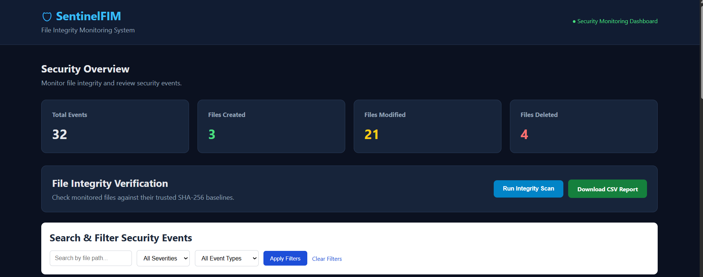
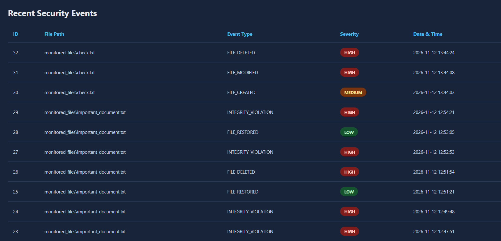
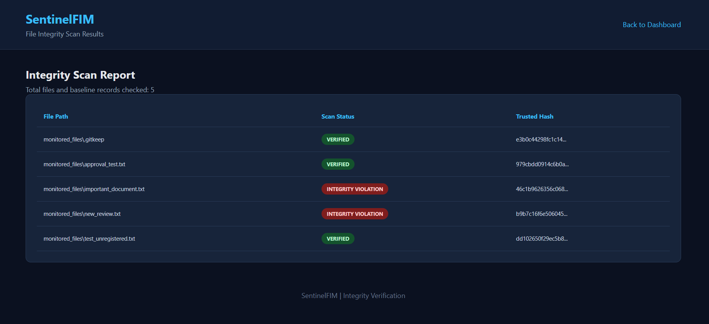

# SentinelFIM – File Integrity Monitoring System

## Overview

SentinelFIM is a Python-based cybersecurity project that monitors files for unauthorized or unexpected changes using SHA-256 cryptographic hashing.

The system maintains trusted file hash baselines, detects file creation, modification and deletion, and records security events in an SQLite database. A Flask web dashboard allows users to review events, perform integrity scans, approve new files and export security reports.


## 📸 Project Screenshots

### 1. SentinelFIM Dashboard
The main dashboard displays security statistics, file integrity verification options, and security event filters.



### 2. Recent Security Events
Displays detected file activities, including file creation, modification, deletion, and integrity violations with severity levels.



### 3. File Integrity Scan Results
Displays the results of SHA-256 integrity verification, identifying verified, unregistered, and modified files.




## Key Features

- **SHA-256 Hashing:** Calculates file hashes to verify file integrity.
- **Trusted Baselines:** Stores trusted file hashes in SQLite.
- **Real-Time Monitoring:** Detects file creation, modification and deletion using Watchdog.
- **Offline Integrity Scanning:** Identifies modified and missing files, including changes that occurred while monitoring was stopped.
- **Security Event Logging:** Records file events with timestamps and severity levels.
- **File Approval:** Allows users to approve unregistered files and establish trusted baselines.
- **Web Dashboard:** Displays security events and activity summaries using Flask.
- **Search and Filtering:** Filters security events by file path, severity and event type.
- **CSV Export:** Generates downloadable security event reports.

## Technologies Used

| Technology | Purpose |
|---|---|
| Python | Application logic |
| hashlib | SHA-256 hashing |
| Watchdog | Real-time file monitoring |
| SQLite | Database and event storage |
| Flask | Web application |
| HTML and CSS | Dashboard interface |

## Project Structure

```text
SentinelFIM/
├── core/
│   ├── integrity.py
│   ├── alerts.py
│   └── scanner.py
├── database/
├── monitored_files/
├── reports/
├── static/
│   └── style.css
├── templates/
│   ├── index.html
│   └── scan_results.html
├── app.py
├── monitor.py
├── test_integrity.py
├── requirements.txt
├── .gitignore
└── README.md
```

## How It Works

1. The application calculates SHA-256 hashes for monitored files.
2. Trusted hashes are stored as baselines in SQLite.
3. Watchdog observes the monitored folder for file-system events.
4. When a file changes, its current hash is compared with its trusted baseline.
5. Detected security events are recorded with timestamps and severity levels.
6. The Flask dashboard displays recorded events.
7. Offline scans identify changes that occurred while real-time monitoring was stopped.

## Installation and Setup

### Prerequisites

- Python 3.12 or compatible Python 3 version
- Git

### 1. Clone the repository

```bash
git clone https://github.com/saiprasad-19/SentinelFIM.git
cd SentinelFIM
```

### 2. Create a virtual environment

```bash
python -m venv venv
```

### 3. Activate the virtual environment

Windows PowerShell:

```powershell
.\venv\Scripts\Activate.ps1
```

### 4. Install dependencies

```bash
pip install -r requirements.txt
```

### 5. Start real-time monitoring

Open the first terminal:

```bash
python monitor.py
```

### 6. Start the Flask dashboard

Open a second terminal in the project folder, activate the virtual environment, and run:

```bash
python app.py
```

### 7. Open the dashboard

Visit:

http://127.0.0.1:5000

## Security Event Severity

| Event Type | Severity |
|---|---|
| FILE_CREATED | MEDIUM |
| FILE_MODIFIED | HIGH |
| INTEGRITY_VIOLATION | HIGH |
| FILE_DELETED | HIGH |
| FILE_RESTORED | LOW |

## Learning Objectives

This project demonstrates practical understanding of:

- File integrity monitoring
- Cryptographic hashing
- Security event detection and logging
- Trusted baselines
- Database operations using SQLite
- Real-time monitoring with Watchdog
- Web application development using Flask

## Future Enhancements

- Email notifications for critical security events
- User authentication and access control
- Additional security reporting capabilities

## Author

Developed as a cybersecurity portfolio project to demonstrate practical skills in Python programming, file integrity monitoring, security event logging and web application development.
